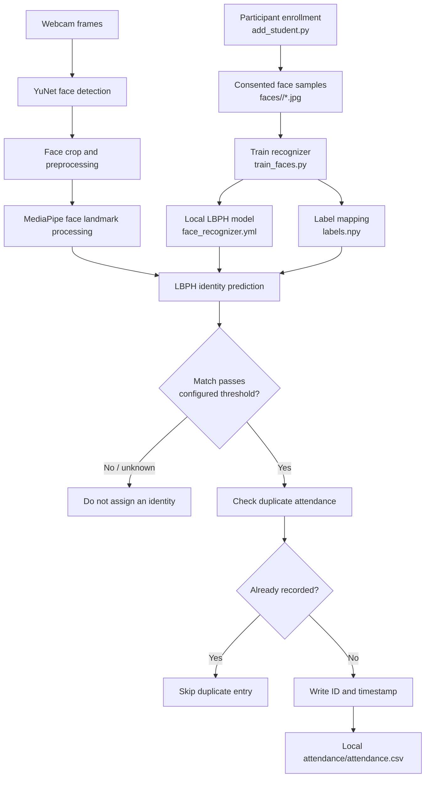

# Face Recognition Attendance System

A Python computer-vision prototype for recording attendance with a webcam. The project combines OpenCV YuNet face detection, LBPH face recognition, and MediaPipe Face Mesh.

> **Status:** Educational prototype. Recognition accuracy depends on image quality, lighting, enrollment data, camera position, and threshold configuration. Do not use this project as the sole basis for high-stakes attendance or identity decisions.

## Features

- Webcam-based face detection and recognition pipeline
- Face enrollment using labelled samples
- Attendance records containing a student identifier and timestamp
- OpenCV image processing with YuNet, LBPH, and MediaPipe components
- Local-first workflow for a computer-vision learning project

## System Workflow Diagram

The diagram below shows the intended end-to-end workflow: enroll consented faces, train the local recognizer, then run webcam recognition and record attendance locally.



> **Note:** This is a workflow diagram, not a guarantee of recognition accuracy. Exact processing order and threshold behavior depend on the implementation and configuration.

## Technology

- Python 3.10–3.12 (dependency versions are pinned in `requirements.txt`)
- OpenCV contrib (includes the `cv2.face` LBPH recognizer)
- YuNet face detector
- MediaPipe Face Mesh / Face Landmarker
- NumPy

## Prerequisites

- Python 3.10, 3.11, or 3.12
- A webcam and camera access
- Windows, macOS, or Linux
- The local model assets listed below

## Setup

Clone the repository:

```bash
git clone https://github.com/muneerahmedkhokhar53-wq/face-recognition-attendance-System.git
cd face-recognition-attendance-System
```

Create and activate a virtual environment.

**Windows PowerShell:**

```powershell
py -3.12 -m venv .venv
.\\.venv\\Scripts\\Activate.ps1
```

**macOS / Linux:**

```bash
python3.12 -m venv .venv
source .venv/bin/activate
```

Install the pinned dependencies:

```bash
python -m pip install --upgrade pip
python -m pip install -r requirements.txt
```

Check that OpenCV exposes the required LBPH recognizer:

```bash
python -c "import cv2, mediapipe, numpy; print('OpenCV:', cv2.__version__); print('MediaPipe:', mediapipe.__version__); print('NumPy:', numpy.__version__); print('LBPH available:', hasattr(cv2, 'face') and hasattr(cv2.face, 'LBPHFaceRecognizer_create'))"
```

The public repository includes the YuNet detector and MediaPipe face-landmarker model. Personal enrollment images and identity-specific training artifacts are intentionally not included. Before running recognition, prepare these local files:

- `faces/<student-id-or-consented-label>/*.jpg` — enrollment crops
- `face_recognizer.yml` — generated by training
- `labels.npy` — generated label mapping

Do not download these identity-specific files from old commits or third-party copies; generate them locally from consented data.

## Run the workflow

1. Enroll a participant with informed consent:

   ```bash
   python add_student.py
   ```

2. Train the local LBPH recognizer:

   ```bash
   python train_faces.py
   ```

3. Start the webcam attendance application:

   ```bash
   python face_reco_mesh_attendance_fixed.py
   ```

Press **Q** or **Esc** to exit the webcam window. Attendance output is written locally under `attendance/attendance.csv`.

## Tests

Run the dependency-free attendance identity logic tests:

```bash
python -m unittest discover -s tests -v
```

GitHub Actions checks unit tests and Python syntax on Python 3.10–3.12. These automated checks do **not** prove that webcam capture, model loading, or real-world recognition works on every machine.

## Privacy and limitations

- **Never commit real student records, enrollment images, trained identity recognizers, label mappings, camera captures, or credentials.** The `.gitignore` excludes common local data paths and generated identity artifacts.
- Attendance spreadsheets, CSV files, face images, recognizer files, and label maps should remain on a controlled local machine unless there is a documented, consented reason to store them elsewhere.
- Removing a file from the latest version does not erase copies from earlier Git history or existing clones. If real personal or biometric-derived data was committed, review repository history and access, and consider making the repository private and rewriting history as appropriate.
- Recognition may fail or misidentify people, particularly with poor lighting, occlusion, pose changes, or low-quality enrollment images.
- LBPH confidence values are not calibrated identity probabilities. Choose thresholds using representative validation samples and measure false-accept and false-reject rates.
- Face Mesh landmarks are not proof of identity.
- This repository should not be treated as a production security system or an unbiased biometric solution.

## Local webcam validation

Use the [Local Webcam Validation Guide](docs/testing.md) for a step-by-step checklist covering known and unknown faces, identity switching, multiple faces, duplicate attendance, face-loss unlocking, camera failures, and safe CSV inspection. The guide separates automated checks from manual hardware checks and includes a test-results template.

## Recommended validation before real use

- Test only with consented, representative samples under different lighting and camera conditions.
- Record false matches, missed detections, and processing latency; do not claim accuracy without a documented test set.
- Review retention, access control, and deletion procedures for locally stored face and attendance data.
- Document tested Python, OpenCV, and MediaPipe versions if the environment differs from the pinned dependency set.

## License

Check the repository for a license file before redistributing or reusing this project.
